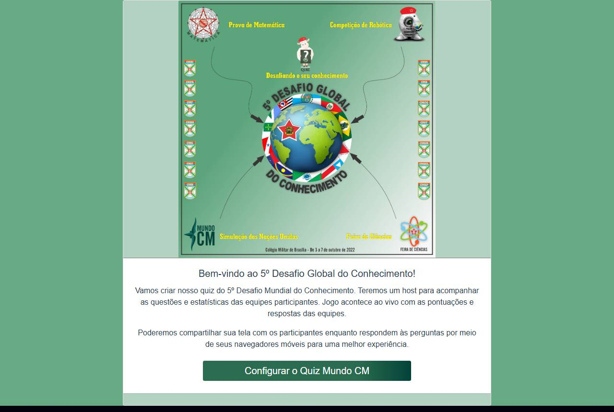

# CM Quiz App

[](https://github.com/douglasabnovato/cm-quiz-app/actions/workflows/ci.yml)

Quiz ao vivo para gincana escolar. Quem organiza cria uma sala e projeta a tela; as equipes entram pelo celular com um link, respondem às perguntas e veem o placar mudar na hora.

Feito para o 5º Desafio Global do Conhecimento do Mundo CM (Colégio Militar). **Projeto de estudo (nível N1)**: Vue 3, Node.js e tempo real com Ably.

| Tela do host (computador) | Tela da equipe (celular) |
|---|---|
|  |  |

## Como funciona

1. O host abre `/`, escreve o nome e cria a sala.
2. O app gera um link `/play?quizCode=<sala>`; as equipes abrem no celular e escrevem o nome da equipe.
3. O host começa o quiz. Cada pergunta tem 30 segundos; acerto vale 5 pontos e cada equipe responde uma vez.
4. Depois de cada pergunta aparece o placar; no fim, o placar final.

Só o host inicia, avança e encerra o quiz. Depois do início, a sala fecha para novas equipes.

## Estado e próximos passos (ciclo de 16/11/2026)

**Critérios do MVP:** 8 de 10 aplicáveis atendidos, **finalizado: não** ([docs/MVP.md](docs/MVP.md)). O critério 8 (acessibilidade) fica parcial: o axe e o teclado cobrem as telas que abrem sem a chave do Ably, e as telas do jogo ao vivo ficam sem axe até o modo local sem Ably (#31, próximo ciclo). O critério 3 depende do responsável: o jogo ao vivo percorrido no navegador exige a chave do Ably (#14). O critério 9 atende desde 16/11/2026: com os alertas do Dependabot ligados, há 0 alertas abertos e o `npm audit --omit=dev` dá 0.

**O que foi feito**
- 16/11/2026, [PR #30](https://github.com/douglasabnovato/cm-quiz-app/pull/30), na sprint `developer/sprint-2026-11-19` (a `main` recebe depois da revisão do responsável):
  - teste no navegador com Playwright e axe no CI (job `e2e`): telas do host e da equipe, teclado, falhas e celular;
  - telas em português, com `lang="pt-BR"`, rótulos nos campos e um `h1` por tela;
  - sem tempo real, o botão "Criar meu Quiz" explica o motivo; a sala que não fica pronta em 20 s avisa e libera o botão;
  - falha ao conferir a sala da equipe vira aviso com "Conferir a sala de novo";
  - Vite 7 no front: `npm audit` sem alertas, também nas dependências de desenvolvimento.
- 09/11/2026, [PR #22](https://github.com/douglasabnovato/cm-quiz-app/pull/22): front em Vue 3 e token do Ably com permissões por canal.
- 06/11/2026, [PR #20](https://github.com/douglasabnovato/cm-quiz-app/pull/20): o servidor sobe sem a chave do Ably e avisa na tela.

**O que queremos fazer**
- [#14](https://github.com/douglasabnovato/cm-quiz-app/issues/14) Chave do Ably para demonstrar o jogo ao vivo (responsável).
- [#31](https://github.com/douglasabnovato/cm-quiz-app/issues/31) Testar o jogo completo sem o Ably, com um modo local.
- [#23](https://github.com/douglasabnovato/cm-quiz-app/issues/23) Token do Ably por papel e por sala.
- [#34](https://github.com/douglasabnovato/cm-quiz-app/issues/34) Reduzir o peso das imagens do cabeçalho.
- [#33](https://github.com/douglasabnovato/cm-quiz-app/issues/33) Gerar o front no deploy, sem versionar o `dist`.
- [#35](https://github.com/douglasabnovato/cm-quiz-app/issues/35) Atualizar o servidor para Express 5 e Ably 2.
- [#16](https://github.com/douglasabnovato/cm-quiz-app/issues/16) e [#32](https://github.com/douglasabnovato/cm-quiz-app/issues/32): publicar no Render e exigir o `e2e` na `main` (responsável).

**Onde está a documentação**
- [docs/MVP.md](docs/MVP.md): critérios, evidências e hipótese.
- [docs/PLANO-DE-ACAO.md](docs/PLANO-DE-ACAO.md): plano de cada ciclo, com pesquisa e fontes.
- [docs/ARQUITETURA.md](docs/ARQUITETURA.md): C4, contratos, canais e permissões do token.
- [docs/DEPLOY.md](docs/DEPLOY.md): publicação no Render, passo a passo.
- [docs/ORIGINAL.md](docs/ORIGINAL.md) e [TUTORIAL.md](TUTORIAL.md): documentação do projeto original, em inglês.

## Como rodar

Requer Node 20.19 ou mais novo. Para o jogo ao vivo, uma conta gratuita na [Ably](https://ably.com); sem a chave, as telas abrem e avisam que o jogo ao vivo está desligado.

```sh
npm install
cp .env.example .env        # preencha ABLY_API_KEY
npm run build:front         # gera realtime-quiz/dist (Vite)
npm start                   # http://localhost:8082
```

## Testes

```sh
npm test                    # regras do jogo, rotas e regras do front (node:test)
npm run lint                # servidor, testes e e2e
npx playwright install chromium
npm run test:e2e            # telas no navegador, sem a chave do Ably, com axe e teclado
cd realtime-quiz && npm run lint && npm run build
```

O CI roda tudo isso em cada PR para `main` e `developer/**` ([.github/workflows/ci.yml](.github/workflows/ci.yml)) e confere se o `realtime-quiz/dist` versionado bate com o build.

## Como é feito

- **Servidor** (`server.js`): Express entrega o front, emite o token do Ably em `/auth` e cria uma *worker thread* por sala (`quiz-room-server.js`).
- **Front** (`realtime-quiz/`): Vue 3, Vue Router 4 e Vite 7.
- **Tempo real:** Ably, com canais por sala e presença. O navegador recebe um token com permissões só nos canais do jogo; a chave fica no servidor.

## Publicação

Fora do ar: `https://cm-quiz-app.onrender.com` responde 404 (conferido em 16/11/2026). O `render.yaml` está pronto; criar o serviço é do responsável ([#16](https://github.com/douglasabnovato/cm-quiz-app/issues/16), passo a passo em [docs/DEPLOY.md](docs/DEPLOY.md)).

## O que aprendi

- Sincronizar um jogo em tempo real com Ably: canais, presença e token com permissões mínimas.
- Separar o servidor Express, que entrega os arquivos e emite tokens, do front em Vue.
- Manter a chave do serviço fora do código, com variáveis de ambiente.
- Testar regras com `node --test` e as telas com Playwright e axe.

## Créditos e licença

Baseado no *realtime-quiz-framework*, projeto open source da Ably, sob a licença Apache-2.0 ([LICENSE](LICENSE)). A documentação original está em [docs/ORIGINAL.md](docs/ORIGINAL.md).
