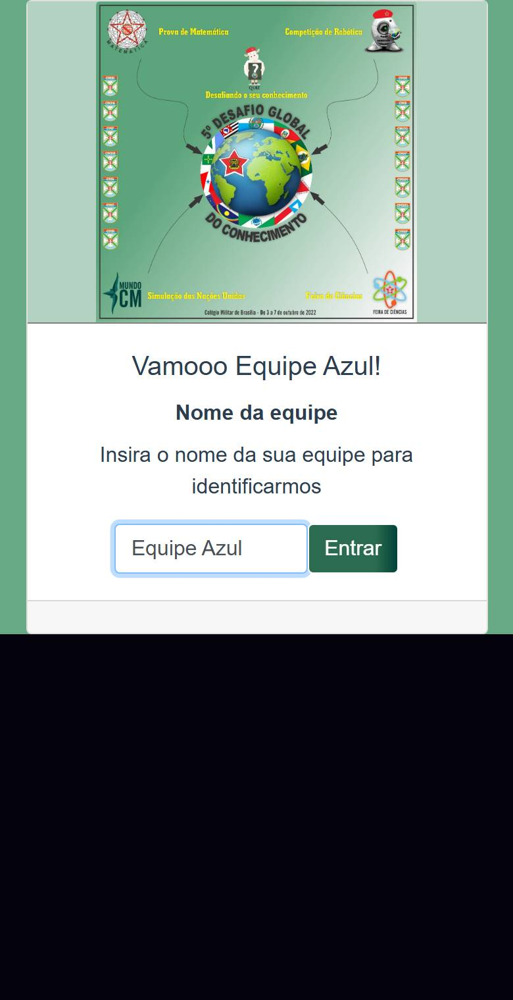

# CM Quiz App

[](https://github.com/douglasabnovato/cm-quiz-app/actions/workflows/ci.yml)

Quiz ao vivo para gincana escolar. Quem organiza cria uma sala e projeta a tela; as equipes entram pelo celular com um link, respondem às perguntas e veem o placar mudar na hora.

Feito para o 5º Desafio Global do Conhecimento do Mundo CM (Colégio Militar). **Projeto de estudo (nível N1)**: Vue 3, Node.js e tempo real com Ably.

| Tela do host (computador) | Tela da equipe (celular) |
|---|---|
|  |  |

## Como funciona

1. O host abre `/`, escreve o nome e cria a sala.
2. O app gera um link `/play?quizCode=<sala>`; as equipes abrem no celular e escrevem o nome da equipe.
3. O host começa o quiz. Cada pergunta tem 30 segundos; acerto vale 5 pontos e cada equipe responde uma vez.
4. Depois de cada pergunta aparece o placar; no fim, o placar final.

Só o host inicia, avança e encerra o quiz. Depois do início, a sala fecha para novas equipes.

## Estado e próximos passos (ciclo de 18/11/2026)

**Critérios do MVP:** 10 de 10 aplicáveis atendidos, **finalizado: sim**, com uma ressalva ([docs/MVP.md](docs/MVP.md)). O jogo completo (sala, equipes, respostas e placar) é testado no navegador e no CI no **modo local**, sem Ably. O percurso com a chave real do Ably segue com o responsável (#14). Este ciclo está na sprint `developer/sprint-2026-11-19` e vai para a `main` depois da revisão do responsável.

**O que foi feito**
- 18/11/2026, [PR #43](https://github.com/douglasabnovato/cm-quiz-app/pull/43), na sprint `developer/sprint-2026-11-19`:
  - modo local do tempo real (`QUIZ_TEMPO_REAL=local`), sem conta nem chave (#31);
  - teste no navegador do jogo completo, com axe nas telas ao vivo e uma resposta só pelo teclado;
  - títulos e contraste corrigidos na pergunta, na resposta, no placar e no fim do quiz;
  - a sala cujo host não entra em 60 s encerra e sai do `/health` (#36).
- 16/11/2026, [PR #30](https://github.com/douglasabnovato/cm-quiz-app/pull/30), na `main` desde 16/11:
  - teste no navegador com Playwright e axe no CI (job `e2e`): telas do host e da equipe, teclado, falhas e celular;
  - telas em português, com `lang="pt-BR"`, rótulos nos campos e um `h1` por tela;
  - sem tempo real, o botão "Criar meu Quiz" explica o motivo; a sala que não fica pronta em 20 s avisa e libera o botão;
  - falha ao conferir a sala da equipe vira aviso com "Conferir a sala de novo";
  - Vite 7 no front: `npm audit` sem alertas, também nas dependências de desenvolvimento.
- 09/11/2026, [PR #22](https://github.com/douglasabnovato/cm-quiz-app/pull/22): front em Vue 3 e token do Ably com permissões por canal.
- 06/11/2026, [PR #20](https://github.com/douglasabnovato/cm-quiz-app/pull/20): o servidor sobe sem a chave do Ably e avisa na tela.

**O que queremos fazer**
- [#31](https://github.com/douglasabnovato/cm-quiz-app/issues/31) e [#36](https://github.com/douglasabnovato/cm-quiz-app/issues/36): levar o modo local e o prazo do host para a `main`.
- [#35](https://github.com/douglasabnovato/cm-quiz-app/issues/35) Atualizar o servidor para Express 5 e Ably 2, com o teste do jogo completo como prova.
- [#14](https://github.com/douglasabnovato/cm-quiz-app/issues/14) Chave do Ably para demonstrar o jogo com o serviço real (responsável).
- [#16](https://github.com/douglasabnovato/cm-quiz-app/issues/16) e [#32](https://github.com/douglasabnovato/cm-quiz-app/issues/32): publicar no Render e exigir o `e2e` na `main` (responsável).

**Onde está a documentação**
- [docs/MVP.md](docs/MVP.md): critérios, evidências e hipótese.
- [docs/PLANO-DE-ACAO.md](docs/PLANO-DE-ACAO.md): plano de cada ciclo, com pesquisa e fontes.
- [docs/ARQUITETURA.md](docs/ARQUITETURA.md): C4, contratos, canais e permissões do token.
- [docs/DEPLOY.md](docs/DEPLOY.md): publicação no Render, passo a passo.
- [docs/ORIGINAL.md](docs/ORIGINAL.md) e [TUTORIAL.md](TUTORIAL.md): documentação do projeto original, em inglês.

## Como rodar

Requer Node 20.19 ou mais novo. Para o jogo ao vivo, uma conta gratuita na [Ably](https://ably.com); sem a chave, as telas abrem e avisam que o jogo ao vivo está desligado.

```sh
npm install
cp .env.example .env        # preencha ABLY_API_KEY
npm run build:front         # gera realtime-quiz/dist (Vite)
npm start                   # http://localhost:8082
```

Sem conta no Ably, dá para jogar no **modo local**, só para testes e estudo: `QUIZ_TEMPO_REAL=local npm start`. O servidor troca o Ably por uma central em memória (`lib/tempo-real-local.js`), sem token nem permissões por canal. Por isso, não use esse modo num site publicado.

## Testes

```sh
npm test                    # regras do jogo, rotas e regras do front (node:test)
npm run lint                # servidor, testes e e2e
npx playwright install chromium
npm run test:e2e            # telas sem a chave e jogo completo no modo local, com axe e teclado
cd realtime-quiz && npm run lint && npm run build
```

O `test:e2e` sobe dois servidores, nas portas 8093 e 8094 (`E2E_PORT` e `E2E_PORT_LOCAL` mudam). O CI roda tudo isso em cada PR para `main` e `developer/**` ([.github/workflows/ci.yml](.github/workflows/ci.yml)) e confere se o `realtime-quiz/dist` versionado bate com o build.

## Como é feito

- **Servidor** (`server.js`): Express entrega o front, emite o token do Ably em `/auth` e cria uma *worker thread* por sala (`quiz-room-server.js`).
- **Front** (`realtime-quiz/`): Vue 3, Vue Router 4 e Vite 7.
- **Tempo real:** Ably, com canais por sala e presença. O navegador recebe um token com permissões só nos canais do jogo; a chave fica no servidor. No modo local, a central em memória faz o papel do Ably: o navegador usa SSE e POST, e a worker da sala usa o `parentPort`.

## Publicação

Fora do ar: `https://cm-quiz-app.onrender.com` responde 404 (conferido em 18/11/2026). O `render.yaml` está pronto; criar o serviço é do responsável ([#16](https://github.com/douglasabnovato/cm-quiz-app/issues/16), passo a passo em [docs/DEPLOY.md](docs/DEPLOY.md)).

## O que aprendi

- Sincronizar um jogo em tempo real com Ably: canais, presença e token com permissões mínimas.
- Separar o servidor Express, que entrega os arquivos e emite tokens, do front em Vue.
- Manter a chave do serviço fora do código, com variáveis de ambiente.
- Testar regras com `node --test` e as telas com Playwright e axe.
- Trocar um serviço externo por um adaptador local com o mesmo contrato, para testar o fluxo inteiro sem conta.

## Créditos e licença

Baseado no *realtime-quiz-framework*, projeto open source da Ably, sob a licença Apache-2.0 ([LICENSE](LICENSE)). A documentação original está em [docs/ORIGINAL.md](docs/ORIGINAL.md).
